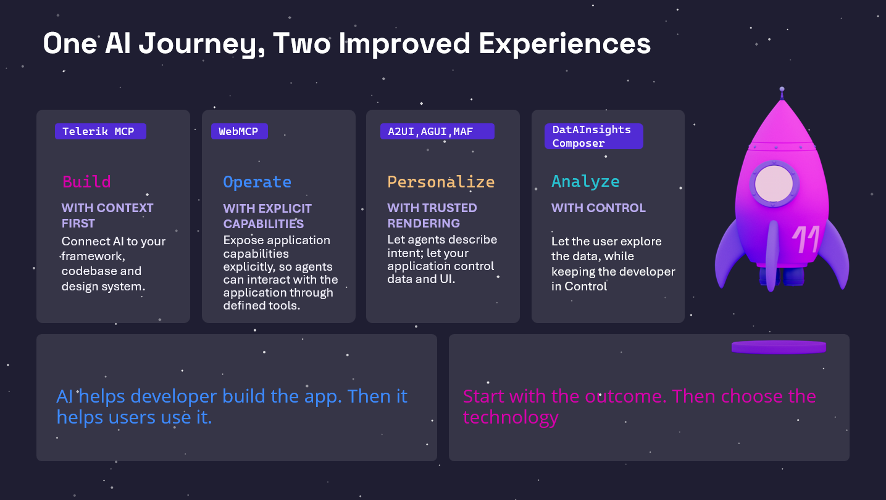

## AI Journey with Telerik UI for Blazor

Content for _"AI Journey with Telerik UI for Blazor: From Developer Productivity to Intelligent User Experience"_ by Maya Mateva, Software Engineering Manager at Progress (.NET Conf).

# Abstract

> One application serves two very different users: the developers who build it and the end users who work
> through it. AI changes both sides of the product. This session follows a two-act journey. Act 1 gives the
> coding agent the context and capabilities it needs (Telerik Blazor MCP). Act 2 lets users explore, personalize
> and analyze through the UI using WebMCP, DatAInsights Composer and A2UI, with the developer in control.
> It is not about adding a chatbot. The developer defines the boundaries, and AI can propose while the
> application enforces what is allowed.

## Key Takeaways

- **Two journeys, one application.** AI supports developers (build, update, maintain) and users (intent, actions, adaptive UI). Human ownership remains.
- **A better prompt is not enough.** The model needs project context, framework knowledge, design context and task capabilities when it writes code.
- **Act 1 – Developer Experience: Telerik Blazor MCP.** One integration with specialized assistants for UI generation, components, styling, upgrades, validation and accessibility.
- **Act 2 – User Experience.**
  - *Explore by asking:* users ask for a grid filter instead of clicking ("Before: Click, Now: Ask"). UI components become AI-callable tools, and a single parameter is enough.
  - *Upgrade custom components:* the free Blazor.WebMcpKit NuGet package exposes tools from your own components (`WebMcpComponentBase`, `[WebMcpTool]`, `[WebMcpParam]`).
  - *Personalized dashboards:* DatAInsights Composer lets users generate charts, data views and insights from approved business data.
  - *Personalized UI:* a wall of text may not be the right interface. Answers can be a chart, form, comparison or editable plan.

- **Dynamic does not mean uncontrolled.** Five guardrails apply:
  - Data: expose only approved datasets and fields.
  - Components: render from a trusted catalog.
  - Actions: validate inputs and authorize operations.
  - Human control: require confirmation for consequential actions.
  - Observability: log, evaluate and monitor agent behavior.

## Technologies Covered

- Telerik Blazor MCP (UI Generator, UI Component, Styling, Upgrade, Validator, Accessibility)
- WebMCP / Blazor.WebMcpKit
- DatAInsights Composer
- A2UI, AG-UI, Microsoft Agent Framework (MAF)

## Resources
- [Telerik MCP/Agentic UI Generator](https://www.telerik.com/blazor-ui/documentation/ai/agentic-ui-generator/overview)
- [Telerik WebMcpKit](https://www.telerik.com/blazor-ui/documentation/ai/web-mcp/overview)
- [Blazor.WebMcpKit on NuGet](https://www.nuget.org/packages/Blazor.WebMcpKit/1.0.0-preview.1)

- Demos:
    - [Telerik WebMCP Extension](https://demos.telerik.com/blazor-ui/marketing-campaigns/webmcp-operations-hub)
    - [Telerik DatAInsights Composer](https://www.telerik.com/datainsights-composer)
    - [A2UI, AGUI, MAF Integration, Telerik UI for Blazor](https://demos.telerik.com/blazor-ui/a2ui/ai-a2ui)

## Contact
If you have questions or want to talk more on those topics, feel free to reach me here: [Maya Mateva](https://www.linkedin.com/in/maya-mateva/) or drop us a line: [Progress](https://www.telerik.com/contact).